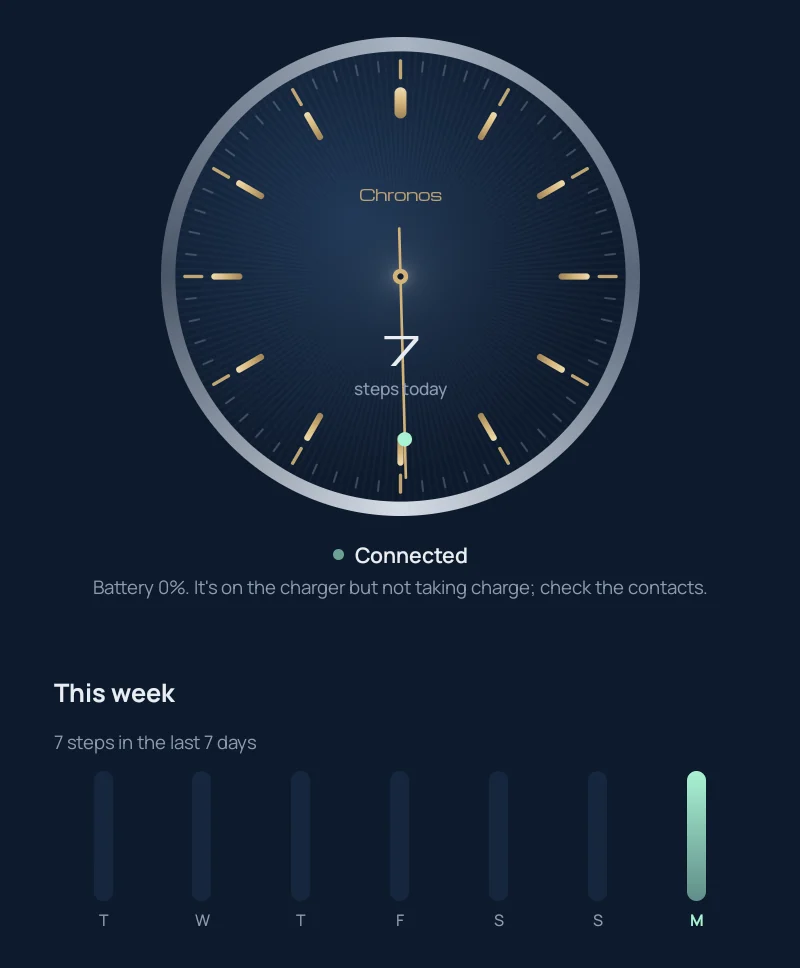
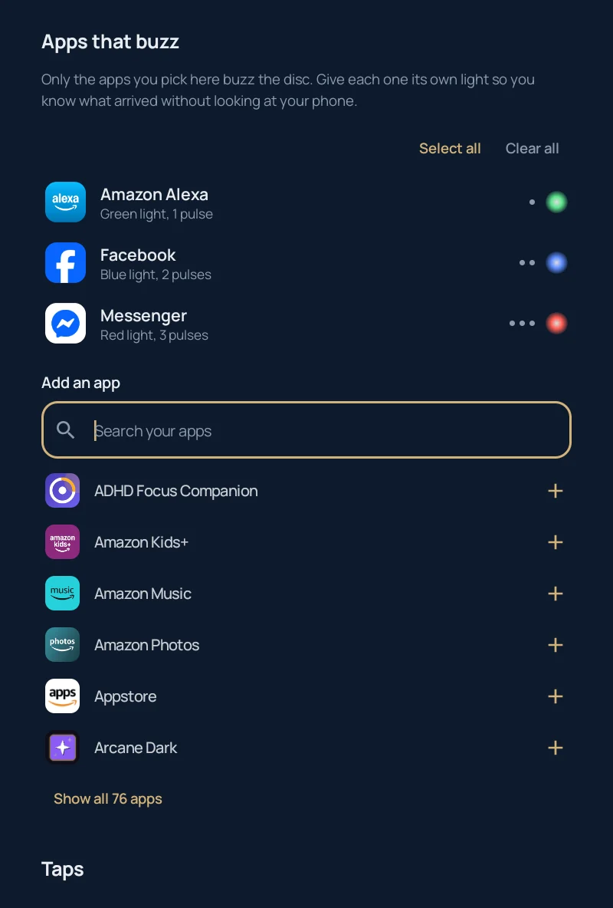

# Chronos Revived

[](https://github.com/chartmann1590/chronos-revived/actions/workflows/ci.yml)

A free, open-source Android app for the **Chronos smart disc**, the little puck that sits under an analog watch and gives it notifications and step tracking. Chronos Wearables shut down along with its app and servers. This app talks to the disc directly over Bluetooth, so nothing depends on them.

**[Website](https://chartmann1590.github.io/chronos-revived/) · [Download the APK](https://github.com/chartmann1590/chronos-revived/releases/latest/download/chronos-revived.apk)**

<p align="center">
  
  
</p>

## Features

- **Notifications on your wrist.** Pick which apps buzz the disc, each with its own light colour (7 colours) and 1–3 pulses. Select all or clear all in one tap. Calls always get through; silent notifications never buzz.
- **Steps.** Live count plus a week chart, pulled from the disc's own history.
- **Battery.** Live level, the cell's real voltage (read through a hidden firmware status mode), charging state and a 24-hour chart.
- **Fast sync.** About 2 seconds from opening the app to fresh steps and battery, on a high-speed Bluetooth link that relaxes again afterwards.
- **Always connected.** Runs in the background with a permanent status notification (battery, steps, last seen). It tells you when the disc goes to sleep or out of range, and reconnects by itself.
- **Taps.** Double tap the crown to play or pause, triple tap to skip, and tap the face repeatedly to ring your phone.
- **Firmware.** Install firmware from a file on a working disc (it restarts into its bootloader and is flashed over Nordic DFU), and recover discs stuck in their bootloader.
- **No account, no cloud, no tracking.**

## Install

1. Download `chronos-revived.apk` from the [latest release](https://github.com/chartmann1590/chronos-revived/releases/latest) and install it (allow installs from unknown sources).
2. Open the app, take the disc off its charger and shake it, then tap **Find my Chronos**.
3. Accept the Bluetooth pairing request. If no window appears, it's waiting in your notification shade.
4. Tap **Allow notification access**, then pick the apps that should buzz.

Requires Android 8.0+ with Bluetooth LE.

### Firmware

The disc firmware belongs to Chronos and is **not** included in this repo. If your disc needs firmware, the app asks you to pick your copy of the original Chronos APK (`com.wearchronos.chronos`) and extracts `firmware.zip` (v0.7.48) from it on the phone.

## Build

```sh
./gradlew assembleDebug          # debug build, installs as com.chronosrevived.debug
./gradlew testDebugUnitTest      # protocol unit tests
./gradlew assembleRelease        # needs keystore.properties (see below)
```

For signed release builds, create `keystore.properties` in the project root (it's git-ignored):

```properties
storeFile=/path/to/release.jks
storePassword=...
keyAlias=...
keyPassword=...
```

### Releases

Releases are fully automatic. Every push to `main` that touches the app runs `.github/workflows/release.yml`, which:

1. picks the next version (patch bump from the latest `v*` tag; add a commit message line reading exactly `Release: minor` or `Release: major` for a bigger bump),
2. runs the tests and builds the APK signed with the release key from repo secrets,
3. creates the tag and a GitHub release with `chronos-revived.apk` and auto-generated notes.

Website and Markdown-only pushes don't release, and `[skip release]` in a commit message skips one. Pull requests run `.github/workflows/ci.yml` (tests plus a debug APK). Local builds are versioned `dev`.

## How it works

The Bluetooth protocol was worked out from the last official Android app and its firmware, then verified against a real disc. See **[PROTOCOL.md](PROTOCOL.md)** for services, status bits, command bytes and hardware notes.

| File | Role |
|---|---|
| `Proto.kt` | Command builders and response parsers |
| `Chronos.kt` | BLE connection, GATT queue, pairing, reconnects |
| `NotifyListener.kt` | Forwards chosen notifications to the disc |
| `Gestures.kt` | Media keys and find-my-phone from tap events |
| `LinkService.kt` | Background service, status notification, disconnect alerts |
| `Firmware.kt` | Firmware import and DFU flashing |
| `Ui.kt` | Compose UI |

## Known limits

- **Charging is controlled by hardware.** The disc's charger chip works on its own and the firmware has no way to force it. The app shows the cell voltage the disc measures. If it reads below about 2.5 V, the charger won't start and the cell needs replacing. Discs that sat unused for years usually end up there.
- Android only for now.

## Disclaimer

Not affiliated with or endorsed by Chronos Wearables. "Chronos" is used only to identify compatible hardware. Licensed under [MIT](LICENSE). Fonts: Michroma and Manrope (SIL Open Font License).
